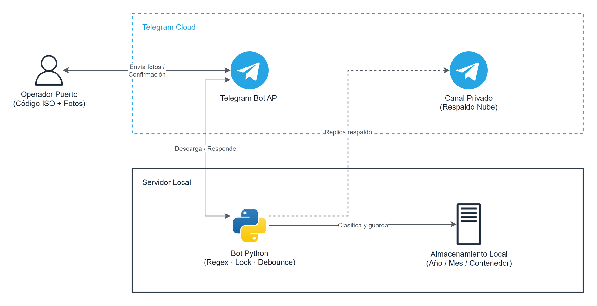

# Respaldo Puerto Bot — Automatización de Evidencia Fotográfica Portuaria

[](https://www.python.org/)
[](https://core.telegram.org/bots/api)
[](#contexto-y-problema)

> Sistema de automatización operacional en Python que captura, valida por regex y respalda fotografías de contenedores en servidor local y canal de Telegram, reduciendo en **90%** el tiempo de registro documental en operaciones portuarias.

---

## Contexto y Problema

En operaciones portuarias, el registro manual de evidencia fotográfica por contenedor (descargar fotos, renombrar, crear carpetas por fecha/código y subir copias de respaldo) consume tiempo operativo y es propenso a errores de clasificación.

Este bot elimina el proceso manual: el operador envía el código del contenedor y la ráfaga de fotos por Telegram, y el sistema valida el formato, organiza automáticamente las carpetas (`Año/Mes/Código_Contenedor`) y replica el respaldo en un canal privado.

---

## Arquitectura del Sistema

Flujo de captura, validación concurrente y doble respaldo (local + nube):



### Flujo de Trabajo y Rol de cada Componente

1. **Captura desde terreno (`Operador Puerto` + `Telegram Bot API`):** El operador envía el código de contenedor (formato ISO 6346) seguido de las fotografías individuales o en ráfaga al chat del bot en Telegram.
2. **Validación y control de concurrencia (`Bot Python`):** El servicio en servidor local recibe los mensajes desde la API de Telegram, valida el código mediante expresión regular (`^[A-Z]{4}\d{7}$`), sincroniza la recepción de ráfagas simultáneas con `threading.Lock` y agrupa la confirmación final con `threading.Timer` (debounce).
3. **Almacenamiento estructurado (`Almacenamiento Local`):** Las imágenes se descargan y clasifican automáticamente en carpetas jerárquicas por `Año/Mes/Código_Contenedor`, asegurando trazabilidad documental.
4. **Respaldo en nube (`Canal Privado Telegram`):** En paralelo, el bot replica el registro fotográfico en un canal privado de Telegram como copia de seguridad externa y envía una única confirmación limpia al operador.

---

## Decisiones Técnicas

- **Validación estricta con Regex:** verifica el código estándar de contenedor (4 letras + 7 dígitos, formato ISO 6346) antes de crear carpetas o aceptar cargas.
- **Control de concurrencia (`threading.Lock`):** evita condiciones de carrera (*race conditions*) al recibir álbumes o ráfagas simultáneas de fotografías desde terreno.
- **Confirmación con Debounce (`threading.Timer`):** agrupa la recepción de múltiples archivos y envía una única confirmación limpia al finalizar la carga masiva.
- **Evolución prevista a AWS:** reemplazar el almacenamiento local por **Amazon S3** con reglas de **Lifecycle** (transición automática a **S3 Glacier Instant Retrieval** para archivo histórico y reducción de costos de almacenamiento) y despliegue del worker en EC2/ECS o Lambda vía webhook.

---

## Seguridad y Configuración

- **Credenciales aisladas:** el token del bot, ID de canal y ruta base se cargan desde `.env` mediante `python-dotenv` (plantilla en [.env.example](.env.example); `.env` excluido en `.gitignore`).
- **Hardening para producción:** restringir acceso por lista blanca de `user_id` autorizados en Telegram, cifrar respaldos en reposo y rotar el token del bot periódicamente.

---

## Estructura del Repositorio

```text
Respaldo_Puerto_Bot/
├── docs/
│   ├── architecture.drawio    # Fuente editable del diagrama (Draw.io)
│   └── architecture.png       # Diagrama de flujo operacional y concurrencia
├── bot.py                     # Lógica del bot, regex, threading.Lock y debounce
├── icono.ico                  # Ícono de empaquetado de escritorio
├── requirements.txt           # Dependencias Python
├── .env.example               # Plantilla de variables de entorno
├── .gitignore
└── README.md
```

---

## Instalación y Uso

```bash
# 1. Clonar repositorio
git clone https://github.com/VitoNez5198/Respaldo_Puerto_Bot.git
cd Respaldo_Puerto_Bot

# 2. Crear entorno virtual e instalar dependencias
python -m venv venv
venv\Scripts\activate
pip install -r requirements.txt

# 3. Configurar credenciales
copy .env.example .env

# 4. Ejecutar el bot
python bot.py
```

**Flujo en operación:**
1. Enviar código de contenedor al chat del bot (ej. `ABCD1234560`).
2. Enviar las fotografías individuales o en ráfaga.
3. Recibir confirmación única al completar el respaldo en `Año/Mes/Código_Contenedor` y en el canal de Telegram.

---

## Autor

**Víctor Martínez** — Junior Cloud Engineer | AWS, FinOps & Applied AI  
AWS Certified Cloud Practitioner • AWS Cloud re/Start • En preparación para SAA-C03

- **Portafolio:** [vitonez5198.github.io/Portfolio-VM](https://vitonez5198.github.io/Portfolio-VM/)
- **LinkedIn:** [victor-ms-dev](https://www.linkedin.com/in/victor-ms-dev/)
- **GitHub:** [@VitoNez5198](https://github.com/VitoNez5198)
